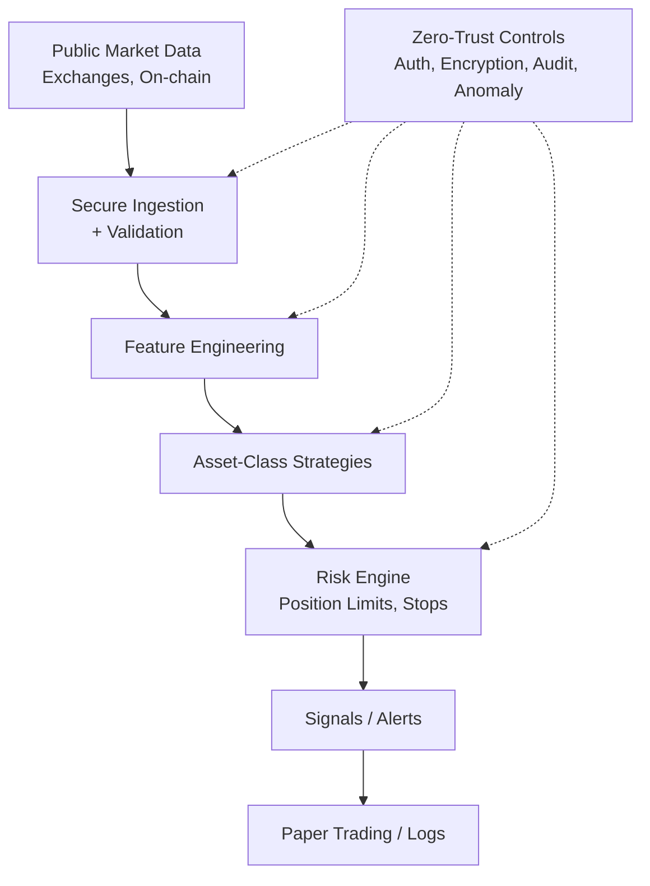

# AIxTech Enhanced Crypto Trading Information System v1

> Enhanced automated cryptocurrency trading information system with multi-asset-class strategies, robust cyber and data security architecture, and AI-agent harness principles for safe development.
>
> **Paper-trading / research only.** No live order execution, no withdrawal permissions. Not financial advice.

[](https://github.com/kkzee92/aixtech-enhanced-crypto-trading-system-v1/actions/workflows/ci.yml)
 

## Overview
Modular framework for crypto trading *information* systems:

- Asset-class specific strategies (Majors, Large Alts, DeFi, Stablecoins, High-Volatility)
- Secure data ingestion (public market data only)
- Risk management & position sizing
- Zero-trust cyber/data security architecture
- AI-agent safe development (AGENTS.md, disclosure trails, CI gates)
- Offline-capable backtesting / simulation hooks

Built with inspiration from the AI coding-agent harness demo at [zeekiankok92/aixtech-agent-harness-demo](https://github.com/zeekiankok92/aixtech-agent-harness-demo).

## Quick Start
```bash
python3 -m venv .venv && source .venv/bin/activate
pip install -r requirements.txt
python -m crypto_trading demo
```

## Architecture
See [docs/architecture.md](docs/architecture.md).



## Asset Class Strategies
| Class | Examples | Focus | Risk |
|-------|----------|-------|------|
| Majors | BTC, ETH | EMA cross + funding/OI + volume | Medium |
| Large Alts | SOL, BNB, ADA | Momentum vs BTC + breakout | Medium-High |
| DeFi | UNI, AAVE, LINK | Price + TVL/fee proxies | High |
| Stables | USDT, USDC | Arb / yield signals | Low |
| High Vol | Memes, new | Strict 0.5-1% risk, time stops | Very High |

Details: [docs/trading-strategies.md](docs/trading-strategies.md)

## Security
[SECURITY.md](SECURITY.md) · [docs/security-architecture.md](docs/security-architecture.md)

- Zero Trust, least privilege, defense in depth
- Secrets via env / vault (never in code)
- Encryption in transit/at rest
- Audit logging, anomaly detection
- CI: lint, tests, secret scan, license check, PDPA-like guards

## AI Agent Rules
See [AGENTS.md](AGENTS.md). Human review required. No production secrets or personal data in prompts.

## Licence
[MIT](LICENSE)
