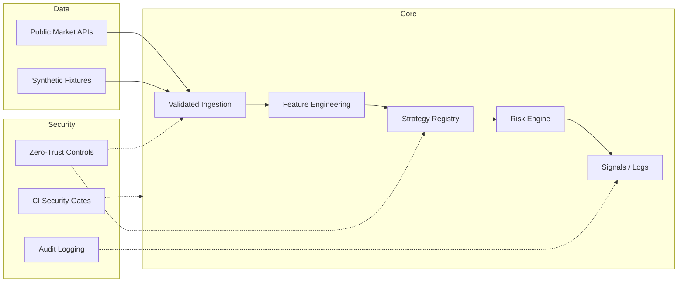

# Architecture Overview

Modular, paper-trading-only information system.

## Key Modules
- `strategies.py`: Asset-class strategy implementations + registry
- `risk.py`: Position limits, volatility circuit breakers
- `cli.py`: Demo entrypoint
- CI workflow + AGENTS.md for safe agent collaboration

All paths are designed to remain offline-testable and free of live execution code.
